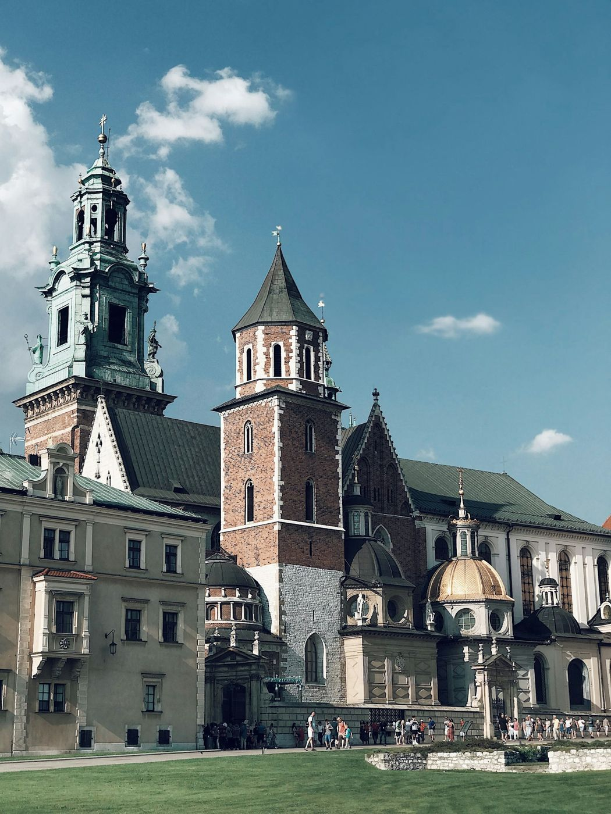

¿Qué hace barato un destino? Para esta lista hemos tenido en cuenta lo que pagas una vez allí (alojamiento, comida y transporte) y que haya vuelos razonables desde España. Las capitales del oeste de Europa son caras; en cambio, en el centro y el este del continente y en los Balcanes el dinero cunde muchísimo más. Y algunas de estas ciudades están entre las más bonitas de Europa.

## 1. Budapest (Hungría)
Palacios junto al Danubio, balnearios termales y los bares en ruinas del barrio judío. Comer en un restaurante local o tomar el transporte público cuesta bastante menos que en España. Lo tienes todo en nuestra guía de [Budapest](/europa/hungria/budapest/).

## 2. Cracovia (Polonia)
Una de las plazas medievales más grandes de Europa, el castillo de Wawel y el barrio judío de Kazimierz. Polonia mantiene el złoty y precios muy contenidos en comida y alojamiento. Más en [Cracovia](/europa/polonia/cracovia/).

*La catedral de Wawel, en la colina del castillo de Cracovia. Foto: Nicola Zhukov (Unsplash)*

## 3. Oporto (Portugal)
De las ciudades más baratas de Europa occidental, a un vuelo corto o unas horas de coche. Vino de Oporto, francesinhas y miradores sobre el Duero. Empieza por nuestra guía de [Oporto](/europa/portugal/oporto/).

## 4. Tirana (Albania)
La capital más sorprendente de los Balcanes: edificios de colores, búnkeres convertidos en museos y una vida de cafés muy animada. Albania es de los países más económicos de Europa, con playas en la Riviera albanesa a pocas horas. Más en [Tirana](/europa/albania/tirana/).

## 5. Kotor (Montenegro)
Una ciudad amurallada al fondo de una bahía entre montañas que parece un fiordo. Sube a la fortaleza al amanecer, antes de que lleguen los cruceros. Fuera del verano, los precios bajan mucho. Más en [Kotor](/europa/montenegro/kotor/).

## 6. Vilna (Lituania)
Un casco antiguo barroco Patrimonio de la Humanidad, iglesias por todas partes y el barrio bohemio de Užupis. Usa el euro, pero con precios bastante más bajos que en el sur de Europa. Más en [Vilna](/europa/lituania/vilna/).

## 7. Brașov (Rumanía)
Una ciudad medieval rodeada de montañas en Transilvania, a un paso del castillo de Bran. Rumanía tiene alojamiento y comida muy asequibles. Más en [Brașov](/europa/rumania/brasov/).

## 8. Brno (Chequia)
La segunda ciudad checa tiene arquitectura modernista, buena cerveza y casi ningún turista, con precios más bajos que [Praga](/europa/chequia/praga/). Está a pocas horas en tren de Viena y de Budapest. Más en [Brno](/europa/chequia/brno/).

## 9. Atenas (Grecia)
La Acrópolis, el barrio de Plaka y una comida callejera buenísima. Más barata que otras capitales mediterráneas, sobre todo si comes souvlaki y no en las terrazas con vistas. Más en [Atenas](/europa/grecia/atenas/).

## 10. Praga en temporada baja (Chequia)
Ya no es tan barata como hace años, pero fuera del verano y de la Navidad sigue siendo más económica que otras grandes capitales. La corona checa y la cerveza a buen precio ayudan. Más en [Praga](/europa/chequia/praga/).

## Cómo organizar la ruta

- **Combina varias en un viaje**: Budapest, Brno y Praga están bien conectadas por tren; Tirana y Kotor se unen por carretera en unas pocas horas.
- **Busca vuelos a la ciudad base**: Budapest, Cracovia y Oporto tienen muchas conexiones directas y baratas desde España.
- **Viaja en primavera u otoño**: hay buen tiempo y precios más bajos que en julio y agosto.

> **Consejo práctico**: en los países que no usan el euro, paga siempre en moneda local y rechaza la conversión que te ofrecen los datáfonos y cajeros: es una de las formas más habituales de pagar de más sin darte cuenta. Una [tarjeta para viajar](/consejos/tarjetas-para-viajar/) sin comisiones te ahorrará dinero en cada pago.

Descubre más listas en [nuestros rankings](/rankings/), como las [ciudades más bonitas de Europa](/rankings/ciudades-mas-bonitas-de-europa/).
