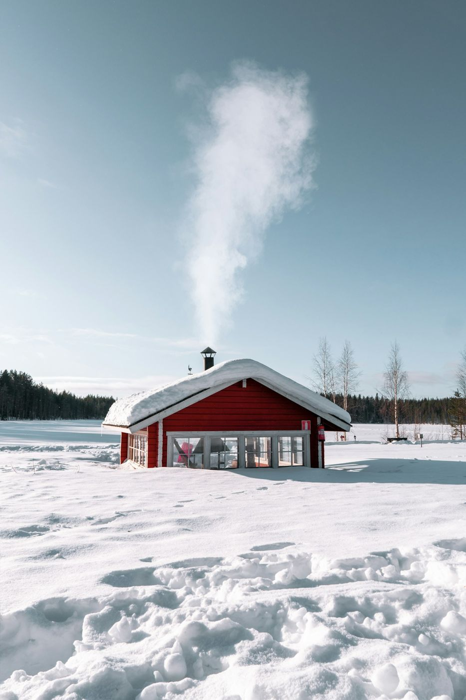

Diciembre es un mes de contrastes para viajar. Las semanas del puente y de Navidad son caras y se llenan, pero entre medias, del 9 al 18 de diciembre aproximadamente, hay un hueco con precios razonables y mucha menos gente. Lo que elijas depende de si buscas luces y frío o sol y playa.

## En España

- **[Canarias](/espana/canarias/)**: en pleno diciembre hay más de 20 grados en la costa y el agua todavía está agradable. [Gran Canaria](/espana/canarias/gran-canaria/) y [Tenerife](/espana/canarias/tenerife/) son las más fáciles; [Lanzarote](/espana/canarias/lanzarote/) es la más tranquila.
- **[Madrid](/espana/madrid/madrid/) en Navidad**: las luces del centro, el mercado de la Plaza Mayor y el ambiente de compras. Ideal para un fin de semana.
- **[Vigo](/espana/galicia/vigo/)**: su iluminación navideña se ha convertido en una de las más famosas de España y llena la ciudad de visitantes cada fin de semana.
- **[Andalucía](/espana/andalucia/)**: [Málaga](/espana/andalucia/malaga/) tiene un alumbrado espectacular en la calle Larios y [Sevilla](/espana/andalucia/sevilla/), sus belenes y conciertos; las dos con temperaturas suaves.
- **Nieve**: la temporada de esquí suele abrir a principios de diciembre en Sierra Nevada, el Pirineo aragonés y [Andorra](/europa/andorra/), si la nieve acompaña.

## En Europa

- **Mercados de Navidad**: [Viena](/cuando-viajar/navidad/viena-en-navidad/), [Praga](/cuando-viajar/navidad/praga-en-navidad/), [Colmar](/cuando-viajar/navidad/colmar-en-navidad/) y [Estrasburgo](/cuando-viajar/navidad/estrasburgo-en-navidad/) son los clásicos. Tienes la lista completa en [los mercados navideños de Europa](/cuando-viajar/navidad/mercados-navidenos-europa/).
- **[Londres](/cuando-viajar/navidad/londres-en-navidad/)**: escaparates, pistas de patinaje y el ambiente de Oxford Street y Covent Garden.
- **[Lisboa](/cuando-viajar/navidad/lisboa-en-navidad/) y [Oporto](/cuando-viajar/navidad/oporto-en-navidad/)**: Navidad sin frío extremo y sin colas, a un vuelo corto.
- **Laponia**: el destino navideño por excelencia. Pocas horas de luz, mucha nieve y, con suerte, auroras boreales. Es caro, así que resérvalo con mucha antelación.

*En Laponia, en diciembre, el día dura apenas unas horas. Foto: Mitchell Henderson (Unsplash)*

## Fuera de Europa

- **[Egipto](/africa/egipto/)**: temperaturas perfectas para ver templos y hacer un crucero por el Nilo, sin el calor del verano.
- **[Tailandia](/asia/tailandia/)**: temporada seca en casi todo el país. Combina [Bangkok](/asia/tailandia/bangkok/) con [sus islas](/asia/tailandia/islas-de-tailandia/).
- **[México](/america/mexico/)**: la península de Yucatán y [Holbox](/america/mexico/holbox/) están en su mejor época, con poca lluvia.
- **[Nueva York](/america/estados-unidos/nueva-york/)**: el árbol del Rockefeller Center y los escaparates de la Quinta Avenida. Hace frío, pero merece la pena.
- **[Cuba](/america/cuba/) y [Costa Rica](/america/costa-rica/)**: empieza la temporada seca, la mejor para viajar.

## Consejos para viajar en diciembre

- **Reserva ya el puente y la Navidad.** Los precios suben cada semana que pasa. Si tienes flexibilidad, viaja entre el 9 y el 18 de diciembre.
- **Días cortos en el norte.** En ciudades como Ámsterdam o Copenhague anochece a media tarde: planifica las visitas por la mañana.
- **Mercados con horario.** Muchos mercados navideños cierran el 23 o el 24 de diciembre. Comprueba las fechas antes de comprar el vuelo.
- **Si vas a esquiar**, revisa que tu póliza cubra los deportes de invierno. Un [seguro de viaje para deportes](https://www.irisglobal.es/particulares/seguros-viajes/deportivo) cubre accidentes en pista y rescates, que un seguro básico no suele incluir.

¿Buscas otras fechas? Mira [dónde viajar en noviembre](/cuando-viajar/noviembre/), las ideas para el [puente de diciembre](/cuando-viajar/puente-de-diciembre/) o [dónde viajar en enero](/cuando-viajar/enero/). Y si lo tuyo es la Navidad, tienes todo en [dónde viajar en Navidad](/cuando-viajar/navidad/).
