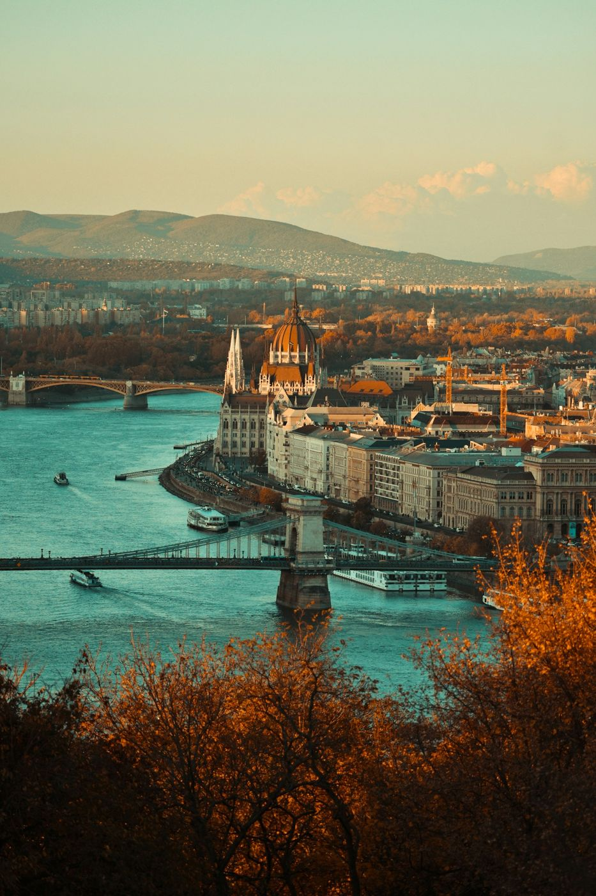

Después de las fiestas, los precios caen en picado. Del 7 de enero a finales de mes, vuelos y hoteles están entre los más baratos del año, y los grandes monumentos de Europa tienen colas cortas. A cambio, toca elegir bien: o buscas el sol del sur o te abrigas y disfrutas de las ciudades sin aglomeraciones.

## En España

- **[Canarias](/espana/canarias/)**: el destino de enero por excelencia. [Gran Canaria](/espana/canarias/gran-canaria/), con las dunas de Maspalomas y el pueblo de Tejeda en la cumbre, y [Fuerteventura](/espana/canarias/fuerteventura/), con sus playas infinitas, son ideales para huir del frío.
- **[Málaga](/espana/andalucia/malaga/) y la Costa del Sol**: días soleados, museos y paseos junto al mar. Combínala con [Nerja](/espana/andalucia/nerja/) y [Ronda](/espana/andalucia/ronda/).
- **[Cádiz](/espana/andalucia/cadiz/)**: en enero se ve la ciudad como la viven los gaditanos, y se empiezan a oír los ensayos de las chirigotas para el Carnaval.
- **Nieve**: es plena temporada de esquí. [Andorra](/europa/andorra/), el Pirineo aragonés y catalán y Sierra Nevada tienen buenas ofertas en las semanas de después de Reyes.

## En Europa

- **[Budapest](/europa/hungria/budapest/)**: sus balnearios termales al aire libre, como Széchenyi, son el mejor plan para enero: agua caliente con nieve alrededor. Y es una de las capitales más baratas de Europa.
- **[Praga](/europa/chequia/praga/) y [Viena](/europa/austria/viena/)**: tras las fiestas se vacían, y el puente de Carlos o el palacio de Schönbrunn se pueden ver casi sin gente.
- **[Roma](/europa/italia/roma/)**: temperaturas suaves para caminar y colas cortas en el Vaticano y el Coliseo.
- **[Lisboa](/europa/portugal/lisboa/)**: una de las capitales más templadas de Europa en invierno. Ideal para una escapada de tres días.
- **[Islandia](/europa/islandia/)**: pocas horas de luz, pero es uno de los mejores meses para ver auroras boreales.

*Budapest desde la colina de Buda: el Parlamento y el puente de las Cadenas. Foto: Keszthelyi Timi (Unsplash)*

## Fuera de Europa

- **[Tailandia](/asia/tailandia/)**: plena temporada seca. Es buen momento para recorrer el norte y terminar en [las islas](/asia/tailandia/islas-de-tailandia/) del mar de Andamán.
- **[Egipto](/africa/egipto/)**: temperaturas ideales para recorrer los templos de Luxor y Asuán.
- **[México](/america/mexico/)**: la península de Yucatán, con [Holbox](/america/mexico/holbox/), está en su mejor época. Y [Ciudad de México](/america/mexico/ciudad-de-mexico/) tiene días soleados y secos.
- **[Vietnam](/asia/vietnam/)**: el sur está seco y caluroso; el norte, más fresco. Ten en cuenta el Año Nuevo lunar, que según el año cae entre finales de enero y febrero y llena el transporte.
- **[Costa Rica](/america/costa-rica/)**: temporada seca en la costa del Pacífico, con buenas condiciones para ver fauna.

## Consejos para viajar en enero

- **Viaja después del 7 de enero.** La diferencia de precio con la semana de Reyes es enorme, sobre todo en vuelos.
- **Aprovecha las rebajas también en los viajes.** Muchas aerolíneas lanzan ofertas en enero para la primavera.
- **En el norte de Europa, días cortos.** Empieza pronto y deja los museos para la tarde.
- **Para los viajes largos**, revisa el pasaporte (muchos países piden al menos seis meses de validez) y los [requisitos de entrada](/consejos/requisitos-y-visados/). Y contrata un [seguro para viajar al extranjero](https://www.irisglobal.es/particulares/seguros-viajes/seguro-viaje) antes de salir: fuera de Europa, una urgencia médica sin seguro puede costar miles de euros.

¿Buscas otras fechas? Mira [dónde viajar en diciembre](/cuando-viajar/diciembre/) o [en febrero](/cuando-viajar/febrero/).
