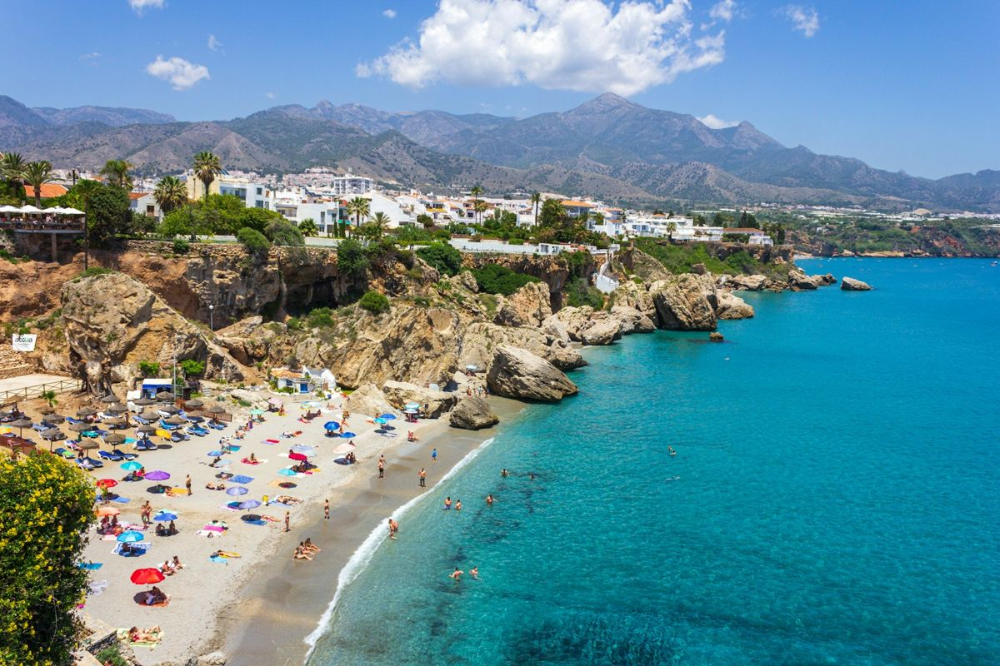

Para hacer esta lista no hemos mirado solo la foto bonita. Hemos elegido playas con un entorno natural bien conservado, agua limpia, algo especial que las haga distintas y que merezcan el viaje, repartidas por toda la costa. Hay calas de agua turquesa, arenales salvajes y alguna playa urbana que no tiene nada que envidiar a las demás.

## 1. Playa de Rodas, Islas Cíes (Pontevedra)
Arena blanca, agua cristalina y un pinar a la espalda, dentro del Parque Nacional de las Islas Atlánticas. Para visitarla necesitas una **autorización gratuita de la Xunta** además del billete de barco, y en verano los cupos se agotan. Se llega en barco desde [Vigo](/espana/galicia/vigo/), Cangas o Baiona. El agua es fría incluso en agosto.

## 2. Playa de Bolonia, Tarifa (Cádiz)
Una duna gigante, pinares y las ruinas romanas de Baelo Claudia junto a la arena. Es de las playas más salvajes de la costa andaluza. Organiza tu visita con nuestra guía de [Tarifa](/espana/andalucia/tarifa/) y consulta el [ranking de las mejores playas de Cádiz](/rankings/mejores-playas-de-cadiz/).

## 3. Cala Macarella, Menorca
El agua turquesa más famosa de Baleares, rodeada de pinos y acantilados. A cinco minutos andando está Macarelleta, todavía más pequeña. En verano el acceso en coche está restringido: ve en autobús o andando por el Camí de Cavalls. Más calas en [las calas de Menorca](/rankings/calas-de-menorca/) y en nuestra guía de [Menorca](/espana/baleares/menorca/).

## 4. Los Genoveses y Mónsul, Cabo de Gata (Almería)
Paisaje volcánico, dunas y aguas tranquilas en el parque natural de [Cabo de Gata](/espana/andalucia/cabo-de-gata/). En temporada alta el acceso en coche se limita y hay autobús lanzadera desde San José.

## 5. Playa de las Catedrales, Ribadeo (Lugo)
Arcos de roca de hasta 30 metros que solo se pueden recorrer con la marea baja. En Semana Santa y verano hay que reservar la entrada gratuita online. Consulta la tabla de mareas y nuestra guía de [Ribadeo](/espana/galicia/ribadeo/).

## 6. Playa de Gulpiyuri, Llanes (Asturias)
Una playa en mitad de un prado, a cien metros del mar, al que está unida por un túnel subterráneo. Una rareza que hay que ver con marea alta. Más ideas en [Llanes](/espana/asturias/llanes/) y en las [mejores playas de Asturias](/rankings/mejores-playas-de-asturias/).

## 7. Playa de La Concha, San Sebastián
La playa urbana más bonita de España, con su barandilla blanca y la isla de Santa Clara en el centro de la bahía. Un paseo al atardecer por el paseo marítimo es obligado. Tienes todo en [San Sebastián](/espana/pais-vasco/san-sebastian/).

## 8. Ses Illetes, Formentera
Una lengua de arena entre dos mares de agua turquesa, en el parque natural de Ses Salines. Llega temprano o en bici: el aparcamiento es de pago y se llena. Más en nuestra guía de [Formentera](/espana/baleares/formentera/).

## 9. Playa de Cofete, Fuerteventura
Doce kilómetros de arena virgen al pie de una sierra, sin chiringuitos ni edificios. Se llega por una pista de tierra y el baño es peligroso por las corrientes: es una playa para contemplar. Organízalo con la guía de [Fuerteventura](/espana/canarias/fuerteventura/).

## 10. Playa de Famara, Lanzarote
Arena dorada, olas para surfear y el risco de Famara como telón de fondo. Las puestas de sol son espectaculares. Tienes más playas en [Lanzarote](/espana/canarias/lanzarote/).

## 11. Playa de Burriana, Nerja (Málaga)
La playa más completa de la Costa del Sol: arena, agua limpia y buenos chiringuitos, a un paseo del Balcón de Europa. Más planes en [Nerja](/espana/andalucia/nerja/).

*La costa de Nerja alterna calas pequeñas y playas largas con todos los servicios. Foto: Fernando Távora (Unsplash)*

## 12. Playa del Silencio, Cudillero (Asturias)
Una concha de cantos rodados encajada entre acantilados verdes, protegida como paisaje natural. No es la más cómoda, pero sí de las más bellas del Cantábrico. Combínala con el pueblo de [Cudillero](/espana/asturias/cudillero/).

## Cómo organizar la ruta

- **Por el norte**: Rodas, las Catedrales, el Silencio y Gulpiyuri se pueden unir en una ruta de una semana en coche por Galicia y Asturias. Mira también las [mejores playas del norte de España](/rankings/mejores-playas-del-norte-de-espana/).
- **Por el sur**: Bolonia, Burriana y Cabo de Gata se reparten por la costa andaluza; necesitarás al menos cinco o seis días para no pasarlo en el coche.
- **Islas**: Macarella y Ses Illetes son para un viaje a Baleares; Cofete y Famara, para Canarias, donde se puede ir a la playa casi todo el año.

> **Consejo práctico**: las playas más famosas tienen cupos, autobuses lanzadera o aparcamientos limitados en verano. Antes de ir, consulta en la web del ayuntamiento o del parque natural si hace falta reserva y cómo se llega en temporada alta.

Descubre más listas en [nuestros rankings](/rankings/).
