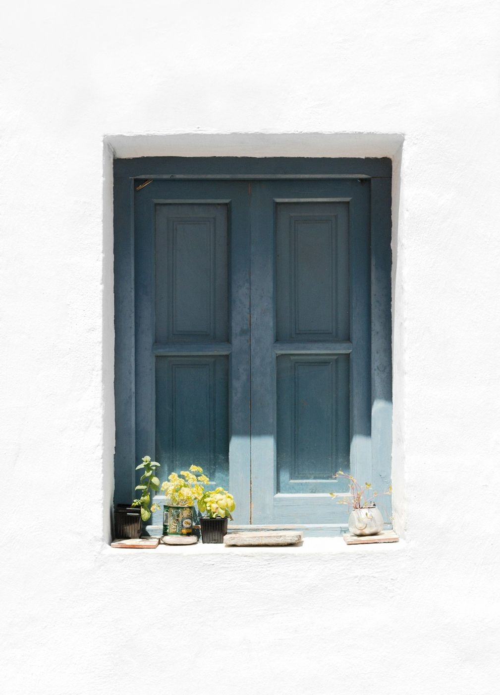

España tiene cientos de pueblos preciosos, así que una lista de doce siempre se queda corta. Nuestro criterio: conjuntos históricos bien conservados, un entorno natural que acompañe y algo que los haga únicos. Hemos intentado que estén todas las Españas: la de piedra, la marinera y la blanca.

## 1. Albarracín (Teruel)
Casas colgadas sobre una hoz del río Guadalaviar, de color rojizo, rodeadas por una muralla que trepa por la montaña. Sube a la torre del Andador al atardecer. Es especialmente bonito en invierno, con nieve.

## 2. Cudillero (Asturias)
Un anfiteatro de casas de colores que bajan hacia el puerto pesquero. Sube a los miradores del Pico y de la Atalaya y termina comiendo pescado en la plaza. Más en nuestra guía de [Cudillero](/espana/asturias/cudillero/).

## 3. Frigiliana (Málaga)
El casco morisco mejor conservado de Andalucía: calles blancas, escaleras con macetas y puertas de colores, en la Axarquía. A diez minutos de [Nerja](/espana/andalucia/nerja/), perfecta para combinar pueblo y playa.

*Frigiliana: paredes encaladas, puertas de colores y macetas en cada esquina. Foto: Sarah Dorweiler (Unsplash)*

## 4. Peñíscola (Castellón)
Un castillo templario sobre un peñón unido a tierra por un istmo, con el casco antiguo amurallado a sus pies. Fuera de agosto, sus callejuelas son mucho más agradables. Organiza la visita desde la [Comunidad Valenciana](/espana/comunidad-valenciana/).

## 5. Santillana del Mar (Cantabria)
Calles empedradas, casonas blasonadas y una colegiata románica. A dos kilómetros está la réplica de las cuevas de Altamira. Tienes más en nuestra guía de [Cantabria](/espana/cantabria/).

## 6. Combarro (Pontevedra)
Hórreos de piedra al borde de la ría, cruceiros y casas marineras. Al atardecer, con la marea alta, es pura postal gallega. Más en [Combarro](/espana/galicia/combarro/).

## 7. Vejer de la Frontera (Cádiz)
Uno de los pueblos blancos más bonitos, en lo alto de una colina, a pocos kilómetros de las playas de la Costa de la Luz. Sigue con nuestra guía de [Vejer de la Frontera](/espana/andalucia/vejer-de-la-frontera/) y con el ranking de [pueblos blancos de Cádiz](/rankings/pueblos-blancos-de-cadiz/).

## 8. Capileira (Granada)
En la Alpujarra, a casi 1.500 metros de altura, con casas blancas de tejados planos y chimeneas, al pie de Sierra Nevada. Es el mejor punto de partida para hacer senderismo por el barranco del Poqueira. Más en [Capileira](/espana/andalucia/capileira/).

## 9. Puebla de Sanabria (Zamora)
Una villa medieval con castillo sobre el río Tera, a un paso del lago de Sanabria, el mayor lago glaciar de la península. Organiza la escapada con nuestra guía de [Puebla de Sanabria](/espana/castilla-y-leon/puebla-de-sanabria/).

## 10. Sigüenza (Guadalajara)
Una catedral fortaleza, un castillo hoy parador y una plaza mayor renacentista. Un plan perfecto de fin de semana desde Madrid. Más en [Sigüenza](/espana/castilla-la-mancha/siguenza/).

## 11. Cadaqués (Girona)
El pueblo blanco de la Costa Brava, aislado tras las montañas del cabo de Creus, donde vivió Dalí. Visita su casa-museo en Portlligat (con reserva). Tienes más planes cerca en [Girona](/espana/cataluna/girona/).

## 12. Valldemossa (Mallorca)
Un pueblo de piedra en la sierra de Tramuntana, famoso por la cartuja donde pasaron un invierno Chopin y George Sand. Prueba la coca de patata. Más en nuestra guía de [Mallorca](/espana/baleares/mallorca/).

## Cómo organizar la ruta

- **Norte**: Cudillero, Santillana del Mar y Combarro se pueden encadenar en una ruta por la cornisa cantábrica y las Rías Baixas.
- **Sur**: Frigiliana, Vejer y Capileira quedan en Andalucía; con cuatro o cinco días y coche puedes ver los tres.
- **Interior**: Albarracín, Sigüenza y Puebla de Sanabria son escapadas de fin de semana. Sigüenza está a menos de dos horas de Madrid.
- **Mediterráneo**: Peñíscola, Cadaqués y Valldemossa, mejor fuera de julio y agosto.

> **Consejo práctico**: si puedes, duerme en el pueblo. Entre las once de la mañana y las seis de la tarde llegan las excursiones; a primera hora y al anochecer, los pueblos recuperan la calma y la luz es mucho más bonita.

Descubre más listas en [nuestros rankings](/rankings/), como las [ciudades más bonitas de España](/rankings/ciudades-mas-bonitas-de-espana/).
