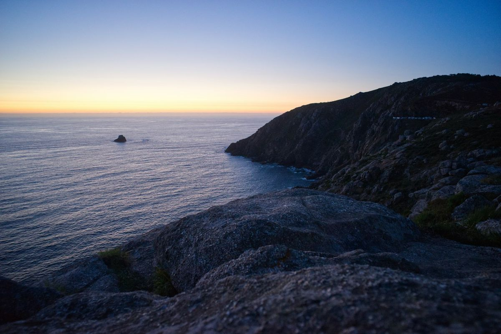

El puente de diciembre es el último gran puente del año y uno de los más esperados. En 2026, el Día de la Constitución (6 de diciembre) cae en domingo, y varias comunidades lo trasladan al **lunes 7**. Junto con la Inmaculada, el martes 8, salen cuatro días seguidos sin gastar vacaciones.

## Dónde es festivo el lunes 7 de diciembre

Según los calendarios laborales autonómicos, el lunes 7 es festivo en Andalucía, Aragón, Asturias, Cantabria, Castilla y León, Extremadura, La Rioja, Comunidad de Madrid, Región de Murcia y Melilla. En el resto, el lunes es laborable: si pides ese día de vacaciones, también tendrás cuatro días seguidos. Comprueba siempre el calendario de tu comunidad y los festivos locales de tu municipio.

## En España

- **[Madrid](/espana/madrid/madrid/)**: luces de Navidad, mercadillo de la Plaza Mayor y teatros. Si vives fuera, es el momento perfecto para una escapada urbana.
- **[Vigo](/espana/galicia/vigo/)**: su alumbrado atrae a miles de visitantes en el puente. Reserva el alojamiento ya, porque se agota.
- **[Segovia](/espana/castilla-y-leon/segovia/) y [Toledo](/espana/castilla-la-mancha/toledo/)**: a una hora de Madrid, perfectas para combinar patrimonio y gastronomía de invierno.
- **[Asturias](/espana/asturias/) y [Cantabria](/espana/cantabria/)**: casas rurales con chimenea, cocina de cuchara y paseos por la costa. Mira pueblos como [Llanes](/espana/asturias/llanes/) o [Cudillero](/espana/asturias/cudillero/).
- **Galicia atlántica**: la Costa da Morte en invierno, con el mar bravo y el faro de Finisterre, tiene una belleza muy distinta a la del verano. [Santiago de Compostela](/espana/galicia/santiago-de-compostela/) es la base ideal.
- **[Canarias](/espana/canarias/)**: si quieres sol, cuatro días dan para una isla. [Lanzarote](/espana/canarias/lanzarote/) o [Gran Canaria](/espana/canarias/gran-canaria/) tienen vuelos directos desde casi toda España.

*La costa de Finisterre al atardecer: el fin del mundo, en pleno invierno. Foto: Alberto Restifo (Unsplash)*

## En Europa

- **Mercados de Navidad**: el puente coincide con su mejor momento. [Viena](/cuando-viajar/navidad/viena-en-navidad/), [Praga](/cuando-viajar/navidad/praga-en-navidad/), [Budapest](/cuando-viajar/navidad/budapest-en-navidad/) y la [Alsacia](/cuando-viajar/navidad/alsacia-en-navidad/) son las apuestas seguras.
- **[Lisboa](/europa/portugal/lisboa/) y [Oporto](/europa/portugal/oporto/)**: Navidad sin frío, cerca y con vuelos baratos si reservas pronto.
- **[Roma](/europa/italia/roma/)**: el 8 de diciembre, día de la Inmaculada, el Papa acude al homenaje a la Virgen en la plaza de España, y la ciudad empieza a vestirse de Navidad.
- **[Cracovia](/europa/polonia/cracovia/)**: uno de los mercados navideños más bonitos y económicos de Europa, en la plaza del Mercado.

## Fuera de Europa

Cuatro días se quedan cortos para un viaje largo, pero hay opciones a pocas horas: **[Marrakech](/africa/marruecos/marrakech/)**, a menos de dos horas de vuelo desde Madrid, con sol y temperaturas suaves; o **[Egipto](/africa/egipto/)**, si te animas a coger uno o dos días de vacaciones.

## Consejos para viajar en el puente

- **Reserva cuanto antes.** Vuelos, trenes y hoteles suben de precio cada semana. Si aún no lo tienes, mira destinos a los que puedas llegar en coche.
- **Sal el viernes por la tarde o el sábado temprano** para aprovechar los cuatro días, y vuelve el martes a primera hora de la tarde para evitar el tráfico.
- **Si viajas por Europa**, lleva la tarjeta sanitaria europea, pero no te fíes solo de ella: no cubre la repatriación ni la sanidad privada. Un [seguro de viaje con asistencia 24 horas](https://www.irisglobal.es/particulares/seguros-viajes/seguro-viaje) cubre lo que la tarjeta no.
- **Carreteras de montaña**: si vas al norte o al Pirineo, lleva cadenas y consulta el estado de los puertos.

Más ideas para estas fechas en [dónde viajar en diciembre](/cuando-viajar/diciembre/) y [escapadas de fin de semana](/cuando-viajar/escapadas-fin-de-semana/).
