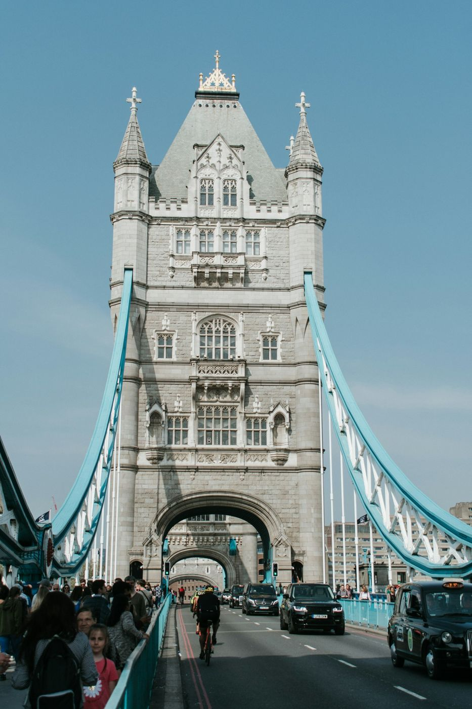

Londres no se acaba nunca, pero el viajero que va por primera vez puede organizarse en torno al río: Westminster a un lado, la City y la Torre al otro, y los grandes museos repartidos entre medias. Muchos de ellos son gratuitos, lo que compensa los precios del resto de la ciudad. Si quieres un plan día a día, mira [Londres en 3 días](/europa/reino-unido/londres/en-3-dias/).

## Westminster

### 1. Big Ben y Parlamento
El Palacio de Westminster y su torre del reloj se ven mejor desde el puente de Westminster o desde la orilla sur. Las visitas al interior del Parlamento se hacen con reserva, normalmente los sábados y en periodos de vacaciones parlamentarias.

### 2. Abadía de Westminster
Aquí se coronan los reyes británicos y están enterrados Newton y Darwin. La entrada es de pago y conviene comprarla online.

### 3. Palacio de Buckingham y el cambio de guardia
El cambio de guardia no se celebra todos los días: comprueba el calendario oficial antes de ir. Llega al menos media hora antes para coger sitio junto a la verja.

### 4. Trafalgar Square y National Gallery
Una de las mejores pinacotecas del mundo, con Van Gogh, Turner y Velázquez, y gratis. Al lado, la National Portrait Gallery.

## Ribera sur

### 5. London Eye
La noria junto al Támesis tiene vistas de toda la ciudad. Compra la entrada con hora online; al atardecer es cuando más se llena.

### 6. Tate Modern y el puente del Milenio
Arte contemporáneo gratis en una antigua central eléctrica. Desde su mirador se ve la cúpula de San Pablo al otro lado del puente.

### 7. Borough Market
El mercado gastronómico más famoso de Londres. Ve con hambre a mediodía entre semana; el sábado está a reventar.

## La City y la Torre

### 8. Torre de Londres
Fortaleza, prisión y hoy casa de las Joyas de la Corona. Haz la visita con uno de los Beefeaters: es gratuita con la entrada y muy divertida.

### 9. Tower Bridge
El puente levadizo más famoso del mundo. Su pasarela superior tiene un suelo de cristal sobre el río.

*Tower Bridge desde la calzada. Si tienes suerte, verás cómo se levanta para dejar pasar un barco. Foto: Lukas Souza (Unsplash)*

### 10. Catedral de San Pablo y Sky Garden
La cúpula de San Pablo tiene una galería con un curioso efecto acústico. Para ver la City desde arriba gratis, reserva el Sky Garden con antelación.

## Grandes museos gratuitos

### 11. British Museum
En Bloomsbury: la piedra Rosetta, los mármoles del Partenón y las momias egipcias. Gratis, aunque se agradece la donación. Ve con un plan: no se puede ver entero en un día.

### 12. Museo de Historia Natural
Ya en South Kensington, el esqueleto de ballena azul del vestíbulo justifica la visita. Ideal si viajas con niños.

### 13. Victoria and Albert Museum
Diseño, moda y artes decorativas. Su patio con cafetería es un oasis.

## Barrios con carácter

### 14. Covent Garden y Soho
Artistas callejeros, tiendas y teatros. Las entradas de última hora para los musicales del West End se compran en las taquillas de Leicester Square.

### 15. Camden Town
Mercados, puestos de comida de todo el mundo y ambiente alternativo junto al canal de Regent's.

### 16. Notting Hill y Portobello Road
Casas de colores y el mercado de antigüedades de Portobello, que se monta los sábados.

> **Consejo práctico**: para entrar en Reino Unido necesitas pasaporte y una autorización electrónica de viaje, la [ETA](https://www.gov.uk/eta), que se tramita online antes de volar. Ya en Londres, no compres billetes sueltos de metro: paga con tu tarjeta o el móvil contactless y el sistema aplica automáticamente el tope diario.

## Sigue organizando tu viaje
- [Londres en 3 días](/europa/reino-unido/londres/en-3-dias/)
- [Dónde comer en Londres bien y barato](/europa/reino-unido/londres/donde-comer/)
- [Dónde alojarse en Londres](/europa/reino-unido/londres/donde-alojarse/)
- [Cuándo ir a Londres y consejos prácticos](/europa/reino-unido/londres/cuando-ir/)
- Vuelve a la [guía completa de Londres](/europa/reino-unido/londres/)
