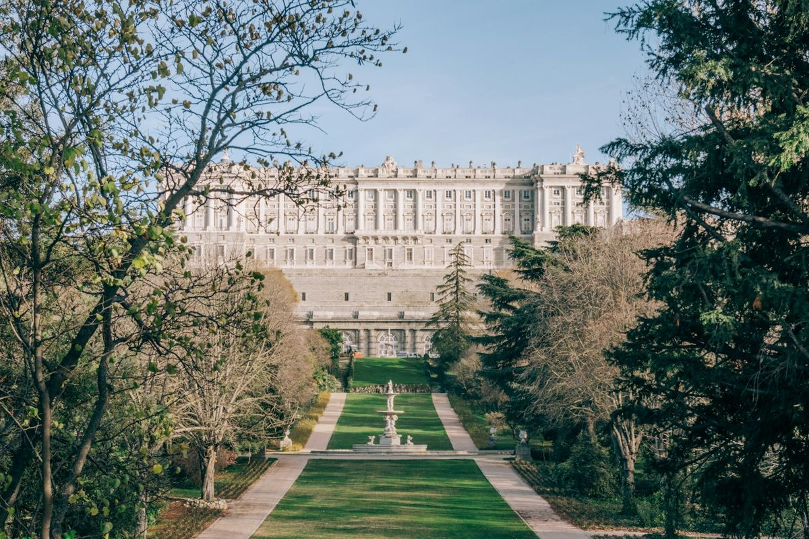

El centro de Madrid es más pequeño de lo que parece en el mapa: entre el Palacio Real y el Retiro hay apenas media hora andando. Por eso esta guía va por zonas, en el orden en que tiene sentido recorrerlas. Si prefieres un plan cerrado día a día, tienes el itinerario de [Madrid en 3 días](/espana/madrid/madrid/en-3-dias/).

## Madrid de los Austrias

### 1. Plaza Mayor
Soportales, balcones de forja y la Casa de la Panadería con sus pinturas en la fachada. Ve temprano por la mañana para verla vacía, y deja el bocadillo de calamares para cualquiera de los bares de las calles de alrededor, que suelen ser más baratos que las terrazas de la plaza.

### 2. Mercado de San Miguel
Una estructura de hierro de principios del siglo XX convertida en mercado gastronómico. Es caro y se llena, pero merece la pena entrar a verlo aunque solo tomes un vermú.

### 3. Puerta del Sol
El kilómetro cero de las carreteras españolas está en el suelo, frente a la Real Casa de Correos. Aquí también está el Oso y el Madroño, el punto de encuentro de medio Madrid.

### 4. Plaza de la Villa y calle Mayor
Uno de los rincones más antiguos de la ciudad, con la Torre de los Lujanes. Pocos turistas se paran aquí y es una pena: es Madrid en estado puro.

## Palacio Real y alrededores

### 5. Palacio Real
La residencia oficial de los reyes, aunque no vivan en él, tiene más de 3.000 estancias. Se visita una parte: el Salón del Trono, la Real Armería y la Farmacia Real. **Compra la entrada online**; los ciudadanos de la UE tienen entrada gratuita las últimas horas de la tarde de lunes a jueves, pero la cola es larga.

*El Palacio Real desde el Campo del Moro, la vista que se pierde casi todo el mundo. Foto: Eduardo Rodriguez (Unsplash)*

### 6. Catedral de la Almudena y Jardines de Sabatini
La catedral está justo enfrente del palacio. Desde su cúpula se ve la sierra en días claros. Los jardines de Sabatini, al lado, son el sitio para ver atardecer.

### 7. Templo de Debod
Un templo egipcio auténtico, regalo de Egipto a España en los años sesenta. Está en un mirador sobre la Casa de Campo y es el atardecer más famoso de Madrid: llega con tiempo.

## El Paseo del Arte

### 8. Museo del Prado
Velázquez, Goya, El Bosco, Tiziano. Si solo tienes dos horas, céntrate en *Las meninas*, las Pinturas negras de Goya y *El jardín de las delicias*. La entrada es gratuita las dos últimas horas de cada día, pero la cola empieza mucho antes.

### 9. Museo Reina Sofía
Arte del siglo XX, con el *Guernica* de Picasso como gran protagonista. También tiene franjas gratuitas por la tarde varios días a la semana.

### 10. Museo Thyssen-Bornemisza
Completa lo que no tienen los otros dos: impresionismo, expresionismo y pintura americana. Es el más tranquilo de los tres.

### 11. Parque del Retiro
El palacio de Cristal, el estanque grande con sus barcas y el Paseo de las Estatuas. Un domingo por la mañana es el mejor momento para ver a los madrileños en su salsa.

### 12. Plaza de Cibeles y Puerta de Alcalá
El Palacio de Cibeles, hoy ayuntamiento, tiene un mirador en lo alto con vistas a la Gran Vía y al Paseo del Prado. La Puerta de Alcalá está a cinco minutos.

## Gran Vía y barrios con vida

### 13. Gran Vía
Edificios de principios del siglo XX, teatros de musicales y tiendas. Para verla desde arriba, sube a una de las terrazas de las azoteas o al Círculo de Bellas Artes.

### 14. Malasaña y Chueca
Calles llenas de bares, tiendas de segunda mano y cafés. Es el Madrid para salir de noche o tomar el vermú del domingo.

### 15. El Rastro y La Latina
El Rastro se monta los domingos por la mañana en la Ribera de Curtidores. Después, la costumbre es ir de cañas por la Cava Baja.

## Fuera del centro

### 16. Estadio Santiago Bernabéu y Madrid Río
El tour del Bernabéu necesita reserva con día y hora. Si prefieres aire libre, Madrid Río es un paseo de varios kilómetros junto al Manzanares, perfecto para ir en bici.

> **Consejo práctico**: reserva el Palacio Real y el tour del Bernabéu con antelación. Para los museos del Paseo del Arte, decide antes si te compensa ir en la franja gratuita: ahorras la entrada, pero pierdes casi siempre media hora de cola y tienes menos tiempo dentro.

## Sigue organizando tu viaje
- [Madrid en 3 días](/espana/madrid/madrid/en-3-dias/)
- [Dónde comer en Madrid bien y barato](/espana/madrid/madrid/donde-comer/)
- [Dónde alojarse en Madrid](/espana/madrid/madrid/donde-alojarse/)
- [Cuándo ir a Madrid y consejos prácticos](/espana/madrid/madrid/cuando-ir/)
- Vuelve a la [guía completa de Madrid](/espana/madrid/madrid/)
