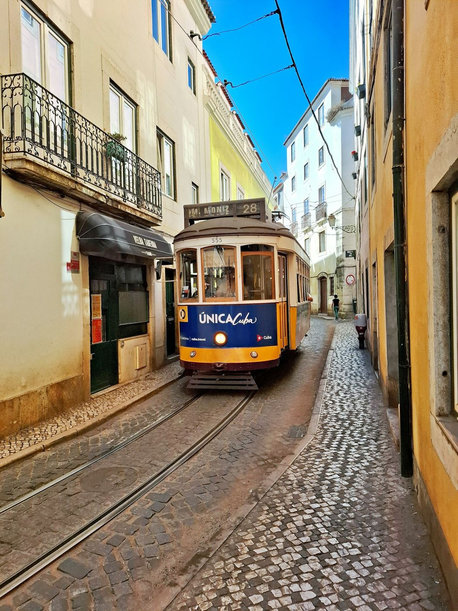

Lisboa está construida sobre colinas, y cada una es un barrio con carácter propio. La forma más cómoda de verla es por zonas: un día para la parte alta y medieval, otro para el centro y la Baixa, y una mañana entera para Belém. Si quieres un plan cerrado, tienes [Lisboa en 3 días](/europa/portugal/lisboa/en-3-dias/).

## Alfama y el castillo

### 1. Castillo de San Jorge
En lo alto de la colina más antigua de la ciudad. Las murallas tienen vistas a toda Lisboa y al Tajo. Ve a primera hora para evitar los grupos.

### 2. Barrio de Alfama
El barrio que sobrevivió al terremoto de 1755: escaleras, ropa tendida y casas de fados. Piérdete sin rumbo y baja hacia el río; es imposible equivocarse.

### 3. Miradores de Santa Luzia y Portas do Sol
Dos miradores casi pegados, con los tejados de Alfama a tus pies. Son de las vistas más fotografiadas de la ciudad.

### 4. Catedral (Sé) y el tranvía 28
La catedral es la iglesia más antigua de Lisboa. Delante pasa el tranvía 28, que cruza los barrios históricos. Súbete en la cabecera de Martim Moniz o muy temprano: a media mañana las colas son de una hora.

*El tranvía 28 por las calles de Alfama. Foto: Rasmus Andersen (Unsplash)*

## Baixa y Chiado

### 5. Praça do Comércio
La gran plaza abierta al río, con el arco de la Rua Augusta. Desde lo alto del arco hay buenas vistas de la Baixa.

### 6. Rua Augusta y la Baixa Pombalina
El barrio reconstruido tras el terremoto en cuadrícula, con calles peatonales llenas de tiendas y cafés.

### 7. Elevador de Santa Justa
Un ascensor de hierro neogótico que une la Baixa con el Chiado. La cola es larga; si solo quieres las vistas, sube andando hasta su mirador por la parte de arriba.

### 8. Chiado y Café A Brasileira
El barrio de las librerías y los cafés literarios. Frente a A Brasileira, la estatua de Fernando Pessoa sentado en la terraza.

### 9. Bairro Alto y mirador de São Pedro de Alcântara
De día, calles tranquilas; de noche, el barrio de bares de Lisboa. El mirador tiene vistas al castillo y a la Baixa.

## Belém

### 10. Monasterio de los Jerónimos
Obra maestra del estilo manuelino y Patrimonio de la Humanidad, con la tumba de Vasco da Gama. Compra la entrada online: la cola de taquilla es de las peores de la ciudad.

### 11. Torre de Belém
La torre defensiva del siglo XVI sobre el Tajo, símbolo de la época de los descubrimientos. Por fuera, la visita es gratis y suele bastar.

### 12. Padrão dos Descobrimentos y los pasteles de Belém
El monumento a los navegantes portugueses tiene un mirador en lo alto. Y antes de irte, para en la antigua fábrica de los pasteles de Belém: la cola avanza rápido.

## Más allá del centro

### 13. LX Factory
Una antigua fábrica bajo el puente 25 de Abril convertida en espacio de tiendas, restaurantes y arte urbano.

### 14. Oceanario de Lisboa
Uno de los acuarios más grandes de Europa, en el Parque de las Naciones. Perfecto para un día de lluvia o si viajas con niños.

### 15. Excursión a Sintra
Palacios de cuento entre la niebla, como el Palacio da Pena y la Quinta da Regaleira. Está a unos 40 minutos en tren desde la estación de Rossio. Dedícale un día entero y reserva las entradas antes.

> **Consejo práctico**: el tranvía 28 y los Jerónimos son las dos grandes colas de Lisboa. Coge el tranvía en su primera parada o antes de las nueve, y compra la entrada de los Jerónimos online. Si piensas usar mucho el transporte, una tarjeta recargable de transporte o el pase de 24 horas te saldrán más baratos que los billetes sueltos del tranvía.

## Sigue organizando tu viaje
- [Lisboa en 3 días](/europa/portugal/lisboa/en-3-dias/)
- [Dónde comer en Lisboa bien y barato](/europa/portugal/lisboa/donde-comer/)
- [Dónde alojarse en Lisboa](/europa/portugal/lisboa/donde-alojarse/)
- [Cuándo ir a Lisboa y consejos prácticos](/europa/portugal/lisboa/cuando-ir/)
- Vuelve a la [guía completa de Lisboa](/europa/portugal/lisboa/)
