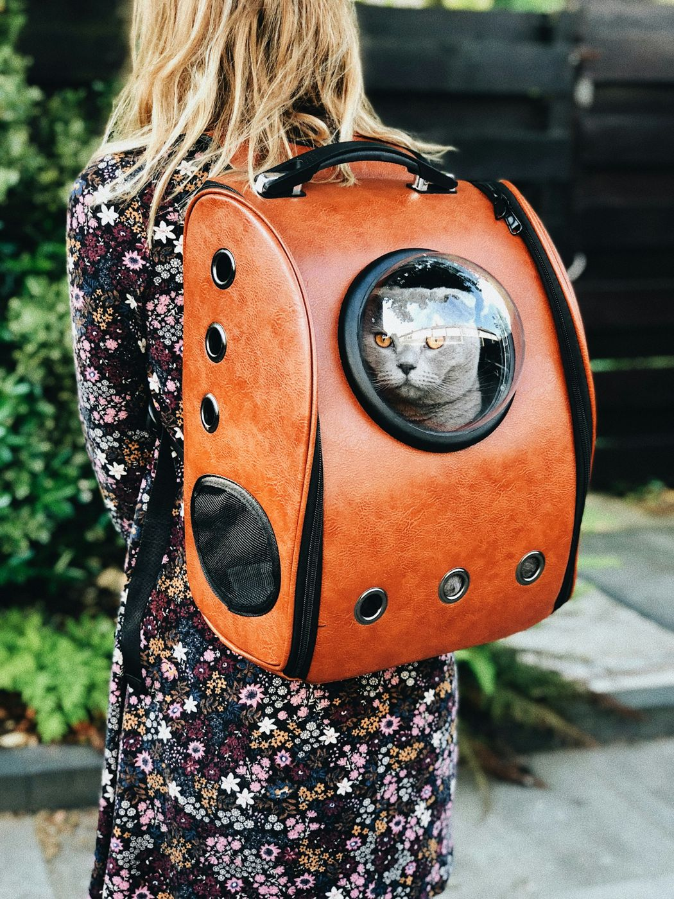

Cada vez más hoteles, trenes y aerolíneas admiten mascotas, pero cada uno tiene sus normas, y los requisitos sanitarios cambian según el país. La clave es empezar a prepararlo con tiempo: en algunos destinos, los papeles tardan meses.

## Documentación: pasaporte europeo, microchip y vacunas

Para viajar con perros, gatos o hurones entre países de la Unión Europea necesitas tres cosas:

1. **Microchip.** Debe ponerse antes que la vacuna de la rabia; si no, la vacuna no vale para viajar.
2. **Vacuna antirrábica en vigor.** La primera dosis se pone a partir de las 12 semanas de edad y tiene que haberse administrado **al menos 21 días antes del viaje**.
3. **Pasaporte europeo para animales de compañía**, que expide tu veterinario y donde constan el microchip y las vacunas.

Algunos países piden algo más. Irlanda, Malta, Finlandia y Noruega exigen además un tratamiento contra la tenia (*Echinococcus*) a los perros unos días antes de llegar, y Reino Unido tiene sus propias normas desde el Brexit. Fuera de Europa, muchos destinos piden un análisis de anticuerpos de la rabia con meses de antelación y un certificado sanitario oficial. Consulta los requisitos en la web del [Ministerio de Agricultura, Pesca y Alimentación](https://www.mapa.gob.es/) y en la embajada del país de destino.

## Cómo viajar en avión, tren, barco o coche

### En avión
La mayoría de aerolíneas admiten perros y gatos pequeños **en cabina, dentro de un transportín bajo el asiento**, con un peso máximo habitual de unos 8 kg sumando animal y transportín. Los más grandes viajan en bodega, en una jaula homologada, y no todas las aerolíneas lo permiten. Las plazas para mascotas por vuelo son limitadas: resérvala al comprar tu billete, no después.

### En tren
Renfe admite animales pequeños en transportín en casi todos sus trenes, y en algunas rutas de alta velocidad ya acepta perros grandes con billete propio y bozal. Comprueba las condiciones y el precio al comprar el billete.

### En barco
Las navieras que van a Baleares y Canarias suelen tener perreras a bordo y, en algunos barcos, camarotes que admiten mascotas. Son pocos: resérvalos con antelación.

### En coche
Es la forma más cómoda. Tu mascota debe ir sujeta con un arnés unido al cinturón, en un transportín bien anclado o detrás de una rejilla separadora: un animal suelto puede ser causa de multa y, sobre todo, de accidente. Para cada dos horas para que beba y estire las patas, y nunca lo dejes solo en el coche al sol.

*Para los gatos, el transportín es su refugio: acostúmbralo a él semanas antes del viaje. Foto: Raoul Droog (Unsplash)*

## Alojamientos y destinos que admiten mascotas

Filtra siempre por "admite mascotas" en los buscadores de alojamiento y confirma las condiciones por escrito: muchos solo aceptan un animal, limitan el peso o cobran un suplemento por noche. En España, el norte es especialmente acogedor con los perros, con muchas casas rurales y playas caninas en [Asturias](/espana/asturias/), [Cantabria](/espana/cantabria/) y [Galicia](/espana/galicia/). En Europa, países como Francia, Alemania o Austria están acostumbrados a ver perros en terrazas, tiendas y transporte público.

## Seguro de viaje para mascotas

Que tu perro enferme o sufra un accidente lejos de casa es una de las situaciones más estresantes de un viaje. Un [seguro de viaje para mascotas](https://www.irisglobal.es/particulares/seguros-viajes/seguro-viaje-mascotas) está pensado precisamente para eso: que los imprevistos de tu animal durante el viaje no arruinen las vacaciones ni el presupuesto. Antes de contratarlo, lee qué coberturas y límites incluye la póliza, y lleva siempre contigo el teléfono de asistencia.

## Errores habituales

- **Poner la vacuna de la rabia tarde.** Si faltan menos de 21 días para el viaje, tu mascota no podrá viajar.
- **No reservar la plaza de la mascota** en el avión o en el tren a la vez que tu billete.
- **Dar por hecho que el hotel acepta perros** porque lo dice el buscador, sin confirmarlo.
- **Cambiarle la rutina de golpe.** Lleva su comida, su cama y algún juguete conocido.

> **Consejo práctico**: haz una carpeta con el pasaporte, la cartilla, una foto reciente de tu mascota y el teléfono de una clínica veterinaria 24 horas en el destino. Si se pierde o necesita atención, tendrás todo a mano.

## Sigue leyendo
- [Seguro de viaje: qué cubre y cómo elegir](/consejos/seguro-de-viaje/)
- [Qué llevar en la maleta](/consejos/que-llevar-en-la-maleta/)
