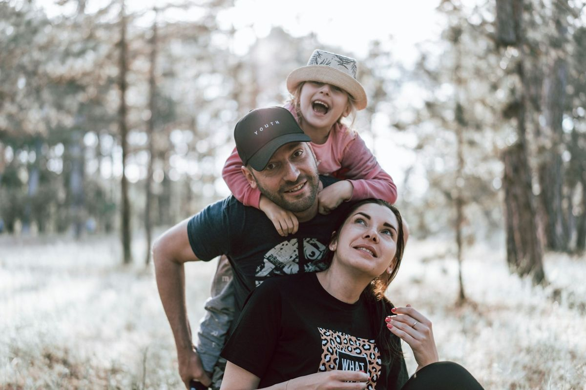

El mejor viaje con niños es el que se adapta a su ritmo y no al revés. Eso significa menos visitas por día, trayectos más cortos y algo de margen para los imprevistos, que los habrá. Con un poco de preparación, viajar en familia es de lo mejor que se puede hacer con ellos.

## Documentación para viajar con niños

- **DNI o pasaporte desde bebés.** Todos los menores necesitan su propio documento para viajar. Dentro de la Unión Europea basta con el DNI; fuera, en la mayoría de países, el pasaporte.
- **Si viaja con un solo progenitor o sin sus padres**, algunos países exigen una autorización firmada del otro progenitor. Para salir de España sin los padres, el menor necesita un permiso de viaje que se tramita en la Policía Nacional o la Guardia Civil.
- **Libro de familia o certificado de nacimiento**, si los apellidos del niño y del adulto que viaja con él no coinciden.
- **Tarjeta sanitaria europea** para cada miembro de la familia si viajáis por Europa. Se pide gratis a la Seguridad Social.

Tienes más detalle en nuestra guía de [requisitos para viajar](/consejos/requisitos-y-visados/).

## Cómo elegir destino

No hace falta renunciar a nada, pero algunos destinos ponen las cosas mucho más fáciles:

- **Vuelos de menos de tres horas** con niños pequeños: [Canarias](/espana/canarias/), [Portugal](/europa/portugal/), [Italia](/europa/italia/) o [Londres](/europa/reino-unido/londres/), con museos gratuitos pensados para ellos.
- **Playas tranquilas y de poca profundidad**: [Menorca](/espana/baleares/menorca/), [Formentera](/espana/baleares/formentera/) o la costa del [Algarve](/europa/portugal/algarve/).
- **Naturaleza y granjas**: el norte de España, de [Asturias](/espana/asturias/) a [Cantabria](/espana/cantabria/), tiene planes para todas las edades.
- **Viajes largos**, mejor a partir de los 5 o 6 años, cuando aguantan bien los vuelos y recuerdan el viaje.

## Alojamiento: lo que marca la diferencia

Un apartamento con cocina y lavadora te da una libertad enorme: desayunos a su hora, cenas sencillas y ropa limpia a mitad de viaje. Si prefieres hotel, busca habitaciones familiares y comprueba si tienen cuna, piscina infantil o actividades. Pide siempre que la ubicación sea céntrica: ahorrarás trayectos y siestas en el carrito.

*Los paseos al aire libre funcionan con todas las edades. Foto: Alexandr Podvalny (Unsplash)*

## En el avión, el tren o el coche

- **Avión**: los bebés suelen viajar en brazos hasta los dos años. Pide los asientos de delante, con más espacio, y dales algo de beber en el despegue y el aterrizaje para aliviar los oídos.
- **Tren**: es la opción más cómoda para trayectos medios. Pueden levantarse, caminar y jugar sin cinturón.
- **Coche**: para cada dos horas. La sillita adecuada a su peso y altura es obligatoria, también en los coches de alquiler: resérvala al hacer la reserva, no al llegar.
- **Entretenimiento**: un juego nuevo, cuentos y algún dibujo descargado sin conexión funcionan mejor que cualquier plan sofisticado.

## Qué llevar en la maleta

Además de lo habitual, no olvides un **botiquín básico** con termómetro, antitérmico infantil, suero, tiritas y la medicación que tomen; una muda de recambio en el equipaje de mano; protector solar y gorro; y su peluche o manta favorita. Tienes una lista completa en [qué llevar en la maleta](/consejos/que-llevar-en-la-maleta/).

## Seguro de viaje: imprescindible con niños

Los niños se ponen malos en el momento más inoportuno: otitis, fiebres, una caída en la piscina. Fuera de Europa, una visita a urgencias sin cobertura puede costar cientos o miles de euros, y en Europa la tarjeta sanitaria solo cubre la sanidad pública. Un [seguro de viaje de Iris Global](https://www.irisglobal.es/particulares/seguros-viajes/seguro-viaje) incluye asistencia médica en el extranjero, repatriación y equipaje, con un teléfono de asistencia disponible las 24 horas. Comprueba que todos los miembros de la familia estén incluidos en la póliza.

## Errores habituales

- **Querer verlo todo.** Con niños, dos visitas al día ya son muchas. Deja tardes libres.
- **Saltarse sus horarios.** Comidas y siestas a su hora evitan la mitad de las rabietas.
- **No reservar con tiempo** las actividades estrella: parques temáticos, acuarios o excursiones tienen plazas limitadas en temporada alta.
- **Olvidar la documentación**: el DNI del bebé se tramita con cita previa y puede tardar.

> **Consejo práctico**: haz partícipes a los niños del viaje. Enséñales fotos del destino, déjales elegir una actividad y dales una cámara o un cuaderno de viaje. Un niño que sabe adónde va se aburre mucho menos.

Sigue con más [consejos para viajar](/consejos/).
